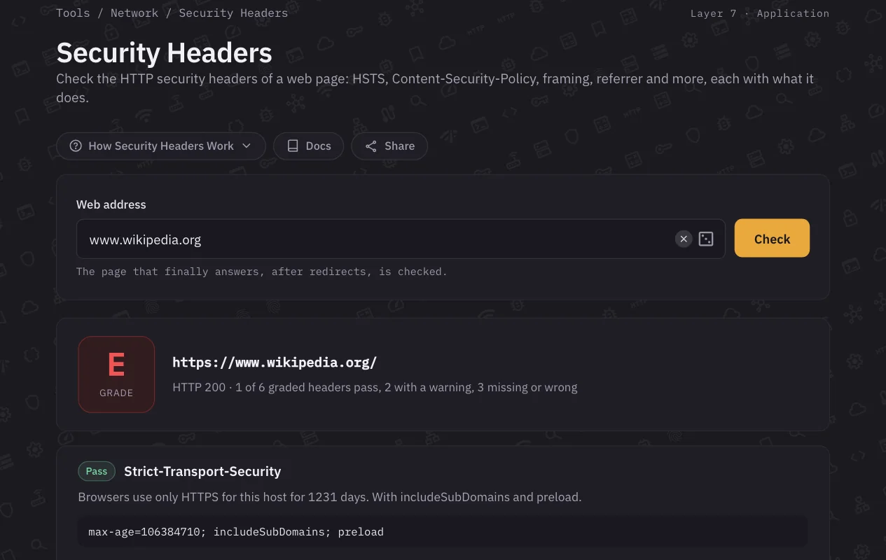

<p align="center">
<a href="https://troubleshooting.tools/check/headers"></a>
</p>

<h1 align="center">Security Headers Check</h1>

<p align="center">Grade the HTTP security headers of a site, see what each one does, and spot repeated headers the way browsers read them.</p>

<p align="center"><a href="https://troubleshooting.tools/check/headers"><b>Open the tool</b></a> &nbsp;·&nbsp; <a href="https://troubleshooting.tools/docs/security-headers">Documentation</a> &nbsp;·&nbsp; <a href="https://disisto.de/project-security-headers">Project page</a></p>

<p align="center"></p>

## Contents

- [Features](#features)
- [On the web page](#on-the-web-page)
- [Links you can share](#links-you-can-share)
- [The six graded headers](#the-six-graded-headers)
- [How the grade is worked out](#how-the-grade-is-worked-out)
- [Reported, but not graded](#reported-but-not-graded)
- [Headers sent more than once](#headers-sent-more-than-once)
- [What is fetched, and how](#what-is-fetched-and-how)
- [A worked example](#a-worked-example)
- [Standards behind the rules](#standards-behind-the-rules)
- [Where it helps](#where-it-helps)
- [Privacy](#privacy)
- [Good to know](#good-to-know)

## Features

- One grade from A+ to F, built from six headers: Strict-Transport-Security, Content-Security-Policy, the framing rules, X-Content-Type-Options, Referrer-Policy and Permissions-Policy.
- A row per header with a verdict, a sentence on what it does or what is missing, and the exact value the server sent.
- Headers that arrive more than once are judged by the rule a browser applies to that particular header, and marked.
- Cross-origin policies, cookie flags and leaked software versions are reported next to the grade.
- Redirects are followed and listed; the grade belongs to the page the chain ends on.
- The request is a GET cut off at the first byte of the body, so only the response headers are read.

## On the web page

1. Open <https://troubleshooting.tools/check/headers>.
2. Type a host such as `github.com` into **Web address**, or paste a full address such as `https://github.com/login`. Without a scheme, HTTPS is assumed.
3. Press **Check**.

The result starts with the grade, the address that finally answered and a status line such as *“HTTP 200 · 5 of 6 graded headers pass, 1 with a warning”*. Below it, every check is one row:

| Part of a row | Meaning |
|---|---|
| Verdict | **Pass**, **Warning**, **Missing**, **Fail** or **Note** |
| Header name | with a **NOT GRADED** tag for rows that do not count, and **sent twice** (or **sent N times**) when the header arrived more than once |
| Explanation | what the header achieves, or what the gap allows |
| Value | the header exactly as the server sent it |

**All response headers** at the bottom opens the complete list, sorted by name and in lower case.

## Links you can share

Put the address to be checked into the link; the check runs as soon as the page opens:

| Target | Link |
|---|---|
| Host name | <https://troubleshooting.tools/check/headers/github.com> |
| A specific page | <https://troubleshooting.tools/check/headers/https://github.com/login> |
| Another host | <https://troubleshooting.tools/check/headers/www.wikipedia.org> |

**Search from the browser address bar.** Add a custom search engine with this URL and a keyword such as `hdr`:

```
https://troubleshooting.tools/check/headers/%s
```

`hdr github.com` then opens the check straight away.

## The six graded headers

| Header | Passes when | Typical warning or failure |
|---|---|---|
| **Strict-Transport-Security** | `max-age` of at least 180 days; `includeSubDomains` and `preload` are noted | a shorter `max-age`, or a page on plain HTTP, where browsers ignore the header |
| **Content-Security-Policy** | scripts are limited to named sources | warning for `'unsafe-inline'` without a nonce, hash or `'strict-dynamic'`, for `'unsafe-eval'`, for sources like `*`, `http:`, `https:` or `data:` (accepted when `'strict-dynamic'` comes with a nonce or hash), for no `script-src` or `default-src`, and for a policy that only reports; no policy at all fails |
| **X-Content-Type-Options** | the value is `nosniff` | any other value |
| **Framing** | CSP `frame-ancestors`, or `X-Frame-Options` with `DENY` or `SAMEORIGIN` | warning for `frame-ancestors` with `*`, `http:`, `https:`, `data:` or `blob:`, and for an `X-Frame-Options` value browsers ignore; missing when neither is set, so any site may embed the page |
| **Referrer-Policy** | a policy that limits what the referrer reveals | warning for `unsafe-url`, `no-referrer-when-downgrade` or a value browsers do not know, and also when the header is missing |
| **Permissions-Policy** | a policy is set | warning when it is missing, so embedded frames may ask for camera, microphone or location |

The CSP check looks for the usual script holes. It does not evaluate the whole policy.

## How the grade is worked out

A **Pass** is worth one point and a **Warning** half a point. **Missing** applies to HSTS, CSP, X-Content-Type-Options and framing and is worth nothing, like a **Fail**; a missing Referrer-Policy or Permissions-Policy is a warning. The points needed for each grade:

| Points | Grade |
|---|---|
| 6 | A |
| 5 to 5.5 | B |
| 4 to 4.5 | C |
| 3 to 3.5 | D |
| 2 to 2.5 | E |
| below 2 | F |

**A+** is an A plus two more things: a Cross-Origin-Opener-Policy of `same-origin` or `same-origin-allow-popups`, and no software version anywhere in the headers.

## Reported, but not graded

These rows carry the **NOT GRADED** tag. They are worth fixing, but they do not change the points:

- **Cross-Origin-Opener-Policy:** needed for A+, otherwise informational.
- **Cross-Origin-Resource-Policy:** whether other sites may load the response as a resource.
- **Software versions:** a `Server` header with a version number, `X-Powered-By`, `X-AspNet-Version` or `X-AspNetMvc-Version`. A leaked version does cost the A+.
- **Set-Cookie:** cookies without `Secure`, `HttpOnly` or a `SameSite` value.
- **X-XSS-Protection:** reported when it is sent with any value other than `0`.

## Headers sent more than once

A reverse proxy and the application often both add the same header. Browsers then follow a rule that differs from header to header, and the check uses the same rule:

| Header | What counts when it appears twice |
|---|---|
| Strict-Transport-Security | the first header only; a header repeating one of its directives is discarded |
| Content-Security-Policy | every policy applies, so the strictest one decides; one header holding several comma-separated policies is split |
| X-Content-Type-Options | the first value |
| X-Frame-Options | the values are read as a set |
| Referrer-Policy | the last value the browser understands |
| Permissions-Policy | all values together, as one list |
| Cross-Origin-Opener-Policy | two values cannot be parsed, so the default `unsafe-none` applies |
| Cross-Origin-Resource-Policy | more than one value counts as not set |

Such a row is marked **sent twice**, or **sent N times** for more, its explanation says how browsers read the repeated header, and the summary counts these cases.

## What is fetched, and how

- The server requests the page itself and follows redirects. Every hop is checked again: public host name, standard port (443 or 80), and every address of the name a public IPv4 address. The request then goes to the very address that passed the check.
- The transfer stops as soon as the body begins; only the headers are read.
- User name and password in the URL, IP addresses and other ports are refused.
- A certificate that browsers would not trust stops the check with a plain error message; the explanation card on the page points to the [SSL/TLS Server Test](https://troubleshooting.tools/check/ssl).

## A worked example

Checking `github.com` gave this at the time of writing:

| Row | Verdict | Why |
|---|---|---|
| Strict-Transport-Security | Pass | one year, with `includeSubdomains` and `preload` |
| Content-Security-Policy | Pass | scripts restricted to named sources |
| X-Content-Type-Options | Pass | `nosniff` |
| Framing | Pass | `frame-ancestors 'none'` |
| Referrer-Policy | Pass, **sent twice** | `origin-when-cross-origin` and `strict-origin-when-cross-origin`; browsers use the last value they recognise |
| Permissions-Policy | Warning | missing |
| Cross-Origin-Opener-Policy | Note, not graded | not set |
| Set-Cookie | Warning, not graded | cookies without `HttpOnly` or `SameSite` |

Five passes and one warning make 5.5 points, which is a **B**. A Permissions-Policy would lift it to A; A+ would additionally need a Cross-Origin-Opener-Policy.

## Standards behind the rules

| Topic | Source of the rule |
|---|---|
| HSTS, including the first-header rule | RFC 6797 |
| `nosniff` and Cross-Origin-Resource-Policy values | the WHATWG Fetch standard |
| X-Frame-Options and Cross-Origin-Opener-Policy | the WHATWG HTML standard |
| Content-Security-Policy, Referrer-Policy, Permissions-Policy | their W3C specifications |

Host names are resolved over DNS over HTTPS (RFC 8484) before every hop.

## Where it helps

**After a deployment.** Paste the link into the release ticket, for example `https://troubleshooting.tools/check/headers/https://github.com/login`, so reviewers see the same result with one click.

**Login and admin pages.** These often sit behind a different configuration than the home page. Check the exact address, not just the host.

**Behind a reverse proxy.** When a header shows **sent twice**, decide whether the proxy or the application owns it and remove the other one.

**Before tightening CSP.** The check names `'unsafe-inline'`, `'unsafe-eval'` and wildcard sources, which are the usual holes to close first.

**Chasing the A+.** Add a Cross-Origin-Opener-Policy and remove version numbers from `Server` and `X-Powered-By`.

There is no public API; the check runs on the web page only. The [documentation](https://troubleshooting.tools/docs/security-headers) lists every rule and message.

## Privacy

- The checked site sees the request coming from the server, never from your browser.
- For the rate limit your address is kept only as a keyed hash.
- There is no result cache; every check fetches the site again.
- Only consent cookies are set, and no content from other sites is loaded on the page.

## Good to know

- Only public host names on the standard HTTPS and HTTP ports can be checked, at every redirect as well.
- Sites are reached over IPv4. A name without an IPv4 address cannot be checked.
- The grade describes the response headers only. Content the page loads later, and headers set by JavaScript, are outside its view.

---

<sub>Part of <a href="https://troubleshooting.tools">troubleshooting.tools</a>.</sub>
